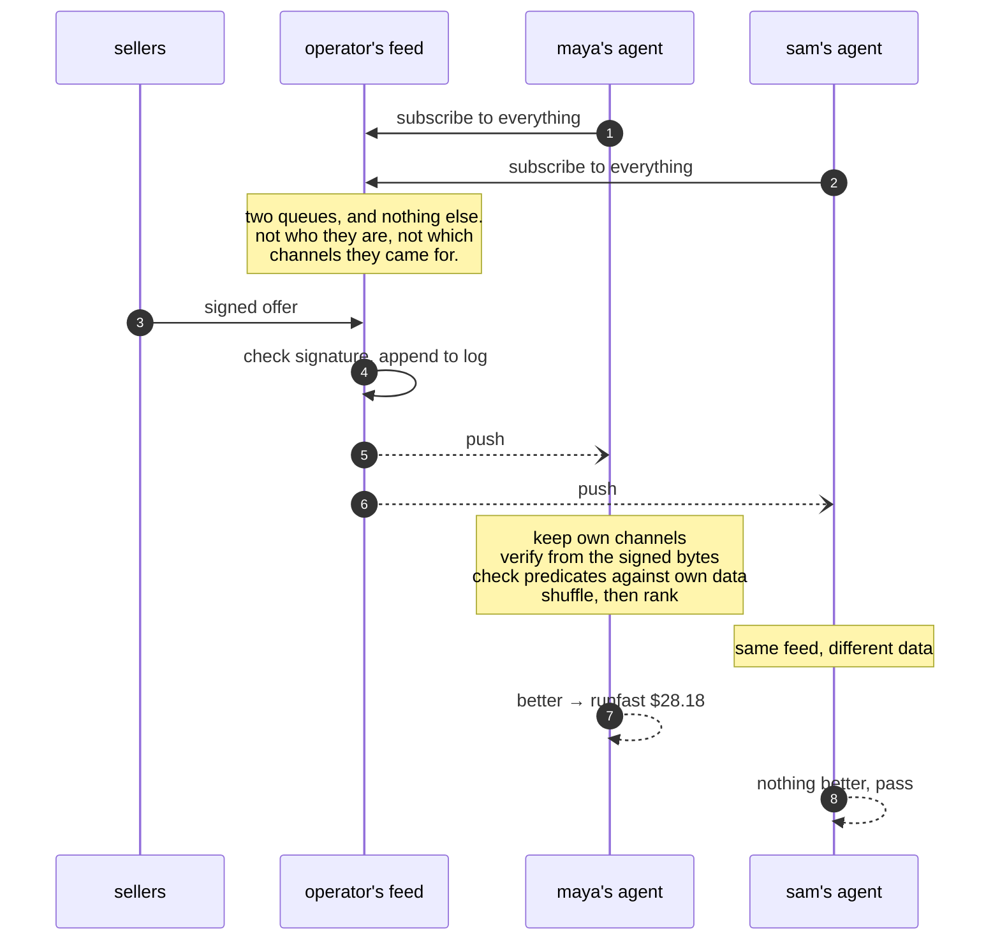

# inbound

One feed businesses post offers into, and agents subscribe to.

An agent that wants something does not go looking for it. It subscribes once, is told when any
offer lands, and keeps the channels its own person cares about. It ranks what it keeps against
that person's situation, on its own machine, and bothers them once. The seller never learns who
was listening, and the operator never learns which channels anyone came for.

[blog.md](blog.md) is the write-up. This is a small working version of it.

## Try it

```bash
cargo run --bin inbound-server
cargo run --bin inbound-watch -- http://127.0.0.1:7402 maya
```

Or open <http://127.0.0.1:7402> and watch the feed arrive in a browser. The page is a reader like
any other: it subscribes to the whole feed, and the directive you set there is applied in the
browser against numbers nothing sends back.

A third terminal makes the point, because the same operator gives a different answer:

```bash
cargo run --bin inbound-watch -- http://127.0.0.1:7402 sam
```

Ten shops post into three channels, all into one feed. Both agents subscribe to the whole feed;
Maya asked hers to watch shoes and would spend $120, so it keeps one channel, and Sam asked for
coffee and shoes and would spend $50, so his keeps two. Neither tells the operator which. Runfast
never wins for Sam: its better terms are for someone who has never bought there, and he has.

## How it works



Steps 6 and 7 are the whole idea: the operator writes to the agents, and neither agent asked.
Steps 8 and 9 are why there is no leaderboard — the filtering and the ranking both run on each
agent's own machine, against facts that never left it, so the same offer is worth different
amounts to different people.

There is one feed rather than one subscription per channel because a subscription is itself a
disclosure. An agent that asked only for `cars/ev/us` would be telling the operator its person is
shopping for a car, which is worth something whether or not a name comes with it. Taking
everything costs bandwidth and reveals nothing.

Who ends up knowing what:

| | Sees the offers | Sees who is listening | Sees what anyone wants | Sees the ranking |
| --- | --- | --- | --- | --- |
| Seller | its own | no | no | no |
| Operator | all | a count | no | no |
| Agent | all | itself | its own user | its own |

"Sees what anyone wants" is where the single feed earns its keep: the operator cannot answer it
even for one channel, because every agent reads the same stream.

The operator's advantage over a search engine is not that it knows more. It knows strictly less.
It is just pointed the other way.

## How an agent finds the feed

One URL in, everything needed to subscribe out.

```bash
curl -s http://127.0.0.1:7402/registry
```

```json
{ "offers": 42,
  "listening": 2,
  "stream": "http://127.0.0.1:7402/feed/stream",
  "since":  "http://127.0.0.1:7402/feed/offers?since=0",
  "mcp":    "http://127.0.0.1:7402/mcp",
  "channels": [
    { "channel": "cashback/us/sportswear", "offers": 21 },
    { "channel": "cashback/us/coffee",     "offers": 15 },
    { "channel": "cars/ev/us",             "offers": 6 } ] }
```

The channel list says what exists. There is one `stream` for all of it, so reading the list and
then subscribing tells the operator nothing about which entry an agent cared about. An agent
catches up through `since`, holds `stream` open, and keeps what its directive names. There is no
registration and no key exchange: reading the feed is anonymous, and the operator learns only that
its subscriber count went up.

Every offer carries two positions. `feed` is the cursor to resume from. `channel_seq` counts
within that offer's own channel, so an agent keeping one channel out of three can still tell it
missed one there — without ever naming the channel. Market-data feeds have done this for decades:
a feed-wide sequence for recovery, a per-instrument sequence for gap detection.

A directory listing several operators would be one more JSON file above this. It does not exist
yet, and for a demo pointing an agent at one URL is enough.

## Directives

An agent is a person's facts plus their standing instruction:

```rust
Directive {
    about: "running shoes before the marathon",
    channels: ["cashback/us/sportswear"],
    budget: 12_000,          // what they would actually spend, in cents
    worth_waking_me: 2_500,  // do not interrupt below this
}
```

The directive decides three things: which channels to keep out of the feed, what the reward is
judged against (so a $4 coffee and a $30,000 car are not compared on percentages), and when the person
wanted to be interrupted.

Holding and surfacing are separate decisions on purpose. Sam's agent held `stride` at $7.56 and
said nothing for five offers, because his bar was $8. When a later offer crossed it, the agent
spoke. An agent that conflates the two either nags or sits quietly on something good.

## Connecting something else

Nothing about the two agents above is special. The feed is plain HTTP:

```bash
curl -N  http://127.0.0.1:7402/feed/stream            # be told
curl -N 'http://127.0.0.1:7402/feed/stream?since=0'   # backlog, then be told
curl -s 'http://127.0.0.1:7402/feed/offers?since=0'   # catch up
```

There is an MCP endpoint at `/mcp` too, so a connector-capable agent attaches by URL instead of
someone writing a client. The operator carries exactly one event type, `inbound.offer`, and the
channel is a field on the payload:

```bash
curl -N -X POST http://127.0.0.1:7402/mcp \
  -H 'Content-Type: application/json' -H 'Accept: text/event-stream' \
  -d '{"jsonrpc":"2.0","id":1,"method":"events/stream","params":{"cursor":"0"}}'
```

Those methods are the draft
[Triggers and Events](https://github.com/modelcontextprotocol/experimental-ext-triggers-events)
extension rather than the resource subscriptions in revision 2026-07-28, whose stream dies with
the transport and keeps no state across reconnects. Offers arrive as `notifications/events/event`,
each carrying the cursor to resume from, and `notifications/events/heartbeat` advances that cursor
while the feed is quiet.

Two places this departs from that draft on purpose. It replays from before the subscription began,
which the draft puts out of scope for v1, because a standing offer is still worth having when an
agent arrives late. And it ships the whole signed offer instead of a minimal payload to be fetched
with a tool, because fetching one would tell the operator which offers an agent cares about.

Every offer arrives as readable JSON **and** as `bytes`, the canonical encoding the seller signed.
`inbound-watch` verifies that signature itself, so an operator that quietly rewrites a rate on the
way past has its offers dropped by the agents reading them.

## What's here

| File | What it holds |
| --- | --- |
| `src/offer.rs` | The offer: signed, typed fields, no free text. Better terms unlocked by a predicate. |
| `src/feed.rs` | The feed: one append-only log across every channel, and the fan-out to everyone listening. |
| `src/rank.rs` | The buyer's side: local predicate checks, then verify, shuffle, sort. |
| `src/directive.rs` | What a person asked their agent to watch for, and what it does about an offer. |
| `src/sellers.rs` | Ten made-up shops across three channels, so the feed has something in it. |
| `src/bin/server/main.rs` | The registry, HTTP and SSE over the feed. |
| `src/bin/server/mcp.rs` | The MCP adapter: the feed as one event type. |
| `src/bin/server/site.html` | The page: the live feed, and a reader that decides in the browser. |
| `src/bin/watch.rs` | An agent that reads the registry, subscribes, and acts on its directive. |

Offers carry fixed fields and nothing a seller could write prose into, which is the point: an
agent reading this feed cannot be talked round the way a web page talks it round. Ranking is
deterministic code over those fields, with the offers shuffled first, so neither arrival order nor
anything the seller chooses can move the result.

Built on [Commonware](https://github.com/commonwarexyz/monorepo) v2026.9.0 — `codec` for the
deterministic bytes a signature needs to mean anything, `cryptography` for namespaced ed25519,
`storage::journal` for the log, `runtime` underneath. No consensus: one operator, one log.

## What this deliberately leaves out

The blog describes a protocol. This is the part of it that makes the demo work, and nothing else.

- **No acceptance, settlement or ledger.** Offers are received and ranked; taking one is out of
  scope here, so nothing is ever bought and no seller is ever billed.
- **One operator.** The registry lists that operator's own channels. A directory of operators
  would sit above it and does not exist.
- **The log is not authenticated.** An agent can tell that an offer was not altered, because the
  seller signed it. It cannot tell that an offer was withheld. Catching an operator that quietly
  drops the best offer needs a root over the log and inclusion proofs against it, which is not
  built.
- **An offer cannot be withdrawn.** The log only grows, so an offer stands until it expires. A
  seller-signed withdrawal appended to the feed is the missing piece, and it is also what any
  measure of a seller's reliability would be computed from.
- **Predicates are checked, never proved.** The agent decides locally whether better terms apply.
  Proving that to a seller, in zero knowledge or otherwise, is the extension the blog describes.
- **No bond.** Anyone with a keypair can post. Making spam cost something needs a deposit the
  operator actually holds.
- **Push only reaches a connected agent.** The cursor exists because an agent that was switched
  off missed everything; waking one that is off needs a webhook, which is not built.
