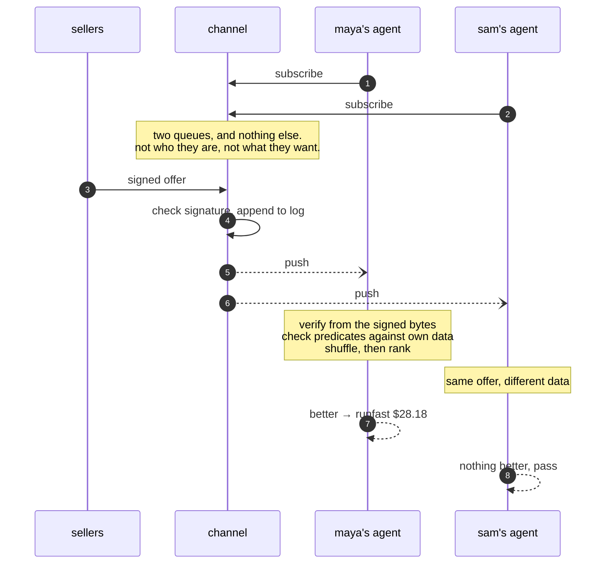

# inbound

A channel businesses post offers into, and agents subscribe to.

An agent that wants something does not go looking for it. It connects to a topic and is told when
an offer lands. It ranks what arrives against its own user's situation, on its own machine, and
bothers the user once. The seller never learns who was listening.

[blog.md](blog.md) is the write-up. This is a small working version of it.

## Try it

```bash
cargo run --bin inbound-server
cargo run --bin inbound-watch -- http://127.0.0.1:7402 maya
```

A third terminal makes the point, because the same feed gives a different answer:

```bash
cargo run --bin inbound-watch -- http://127.0.0.1:7402 sam
```

Maya is new to every shop and buys a $120 basket. Sam already shops at runfast and buys a $50 one.
They receive identical offers and hold different ones. Runfast never wins for Sam, because the
better terms are for someone who has never bought there, and Sam has. Neither agent asks the
channel anything, and neither user is interrupted.

## How it works



Steps 6 and 7 are the whole idea: the channel writes to the agents, and neither agent asked. Steps
8 and 9 are why there is no leaderboard — the ranking runs on each agent's own machine, against
facts that never left it, so the same offer is worth different amounts to different people.

Who ends up knowing what:

| | Sees the offers | Sees who is listening | Sees what anyone wants | Sees the ranking |
| --- | --- | --- | --- | --- |
| Seller | its own | no | no | no |
| Channel | all | a count | no | no |
| Agent | all | itself | its own user | its own |

The channel's advantage over a search engine is not that it knows more. It knows strictly less. It
is just pointed the other way.

## Connecting something else

Nothing about the two agents above is special. The channel is plain HTTP:

```bash
curl -N  http://127.0.0.1:7402/channels/cashback/us/sportswear/stream          # be told
curl -s 'http://127.0.0.1:7402/channels/cashback/us/sportswear/offers?since=0' # catch up
```

There is an MCP endpoint at `/mcp` too, so a connector-capable agent attaches by URL instead of
someone writing a client. It has `list_offers` as a tool, and pushes through a resource
subscription:

```bash
curl -N -X POST http://127.0.0.1:7402/mcp \
  -H 'Content-Type: application/json' -H 'Accept: text/event-stream' \
  -d '{"jsonrpc":"2.0","id":1,"method":"subscriptions/listen","params":{}}'
```

Every offer arrives as readable JSON **and** as `bytes`, the canonical encoding the seller signed.
`inbound-watch` verifies that signature itself, so an operator that quietly rewrites a rate on the
way past has its offers dropped by the agents reading them.

## What's here

| File | What it holds |
| --- | --- |
| `src/offer.rs` | The offer: signed, typed fields, no free text. Better terms unlocked by a predicate. |
| `src/channel.rs` | The channel: an append-only log, and the fan-out to everyone listening. |
| `src/rank.rs` | The buyer's side: local predicate checks, then verify, shuffle, sort. |
| `src/sellers.rs` | Four made-up shoe shops, so the channel has something in it. |
| `src/bin/server.rs` | HTTP, SSE and MCP over a channel. |
| `src/bin/watch.rs` | An agent that connects to a channel it does not run. |

Offers carry fixed fields and nothing a seller could write prose into, which is the point: an
agent reading this channel cannot be talked round the way a web page talks it round. Ranking is
deterministic code over those fields, with the offers shuffled first, so neither arrival order nor
anything the seller chooses can move the result.

Built on [Commonware](https://github.com/commonwarexyz/monorepo) v2026.9.0 — `codec` for the
deterministic bytes a signature needs to mean anything, `cryptography` for namespaced ed25519,
`storage::journal` for the log, `runtime` underneath. No consensus: one operator per channel.

## What this deliberately leaves out

The blog describes a protocol. This is the part of it that makes the demo work, and nothing else.

- **No registry.** An agent is pointed at a channel rather than discovering one.
- **No acceptance, settlement or ledger.** Offers are received and ranked; taking one is out of
  scope here.
- **Predicates are checked, never proved.** The agent decides locally whether better terms apply.
  Proving that to a seller, in zero knowledge or otherwise, is the extension the blog describes.
- **No bond.** Anyone with a keypair can post. Making spam cost something needs a deposit the
  operator actually holds.
- **Push only reaches a connected agent.** The cursor exists because an agent that was switched
  off missed everything; waking one that is off needs a webhook, which is not built.
